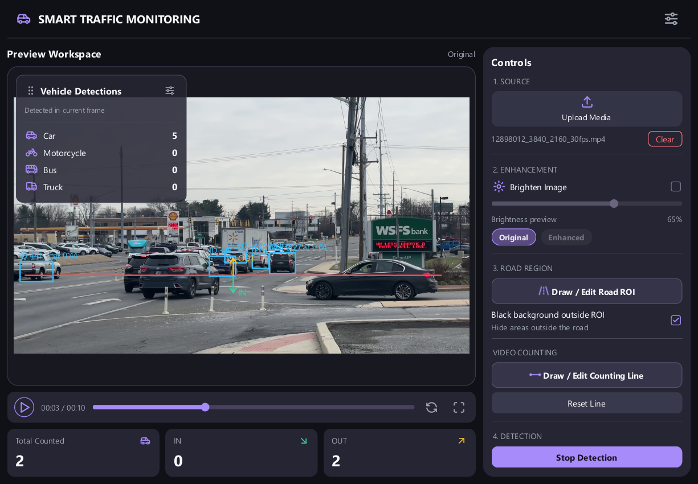
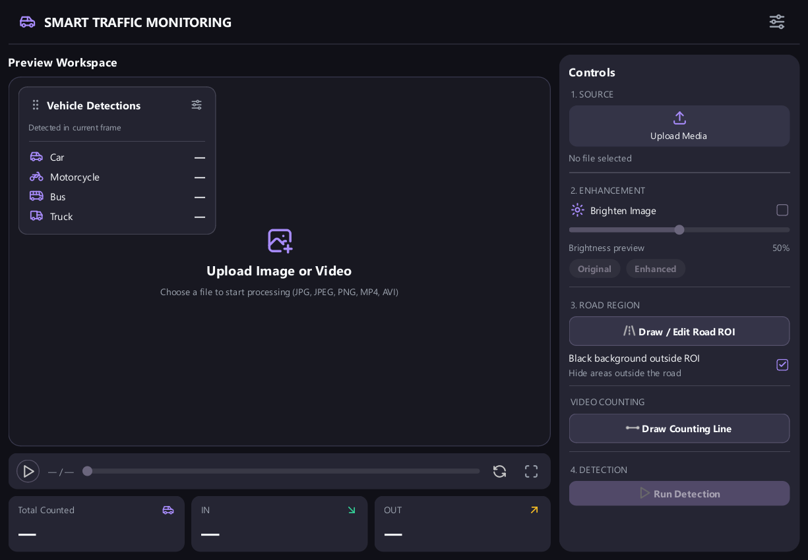
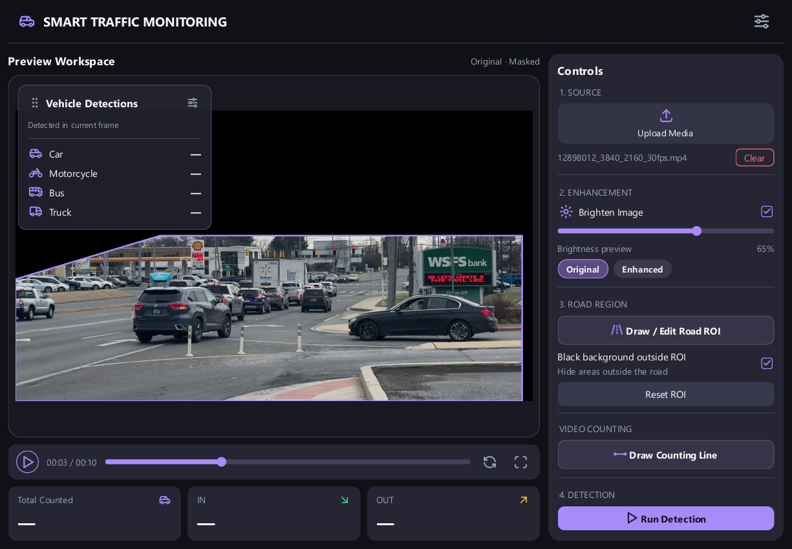
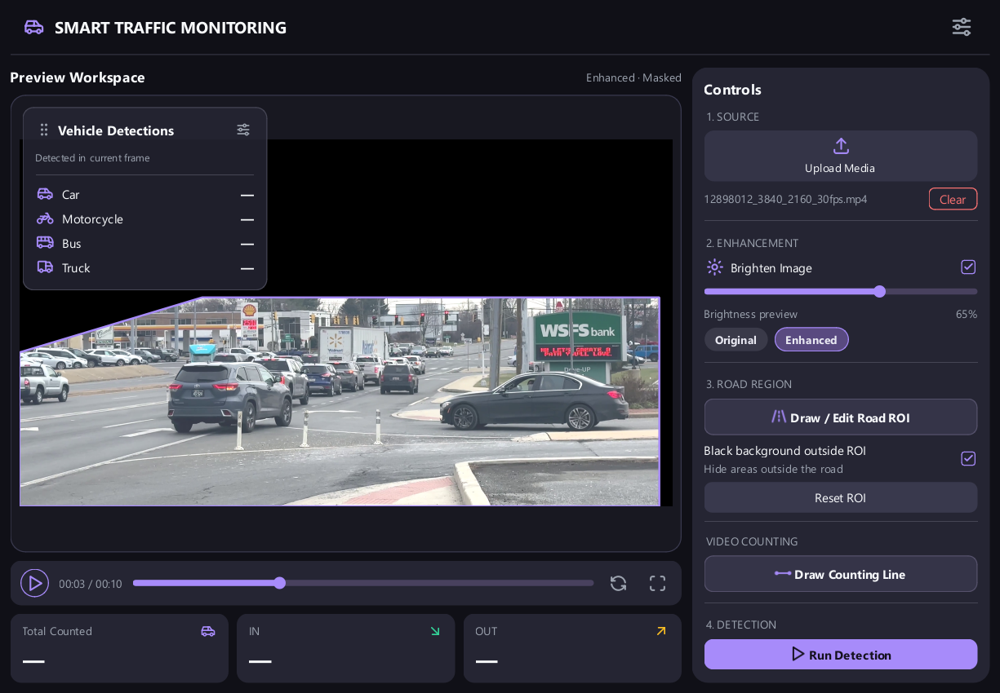
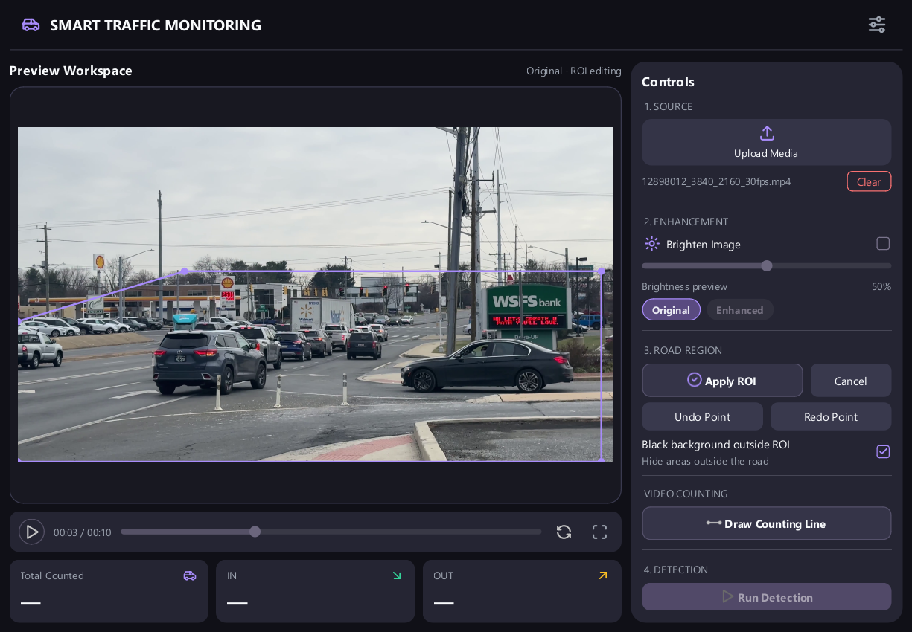
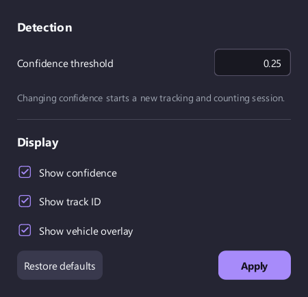

# Smart Traffic Monitoring

โปรแกรม Desktop สำหรับตรวจจับ ติดตาม และนับยานพาหนะจากภาพหรือวิดีโอถนน พัฒนาด้วย **Python, PyQt6, OpenCV และ YOLO11** โดยใช้โมเดลของทีมที่ `model/smart_traffic.pt`

โครงงานนี้สาธิตการนำ Computer Vision และ AI model มาใช้งานผ่าน GUI ตั้งแต่เตรียมภาพ เลือกพื้นที่ถนน ตรวจจับประเภทของรถ ไปจนถึงการประยุกต์นับรถข้ามเส้น เพื่อเก็บข้อมูลประกอบการวิเคราะห์การจราจร



## ฟังก์ชันปัจจุบัน

| ส่วน | การทำงาน |
| --- | --- |
| Source | เปิดภาพ JPG, JPEG, PNG หรือวิดีโอ MP4, AVI จากเครื่อง และ Clear กลับหน้าว่าง |
| Preview | แสดงภาพพร้อมกรอบ ชื่อคลาส confidence และ Track ID เมื่อมีข้อมูล |
| Playback | Play/Pause, แสดงเวลา, เลื่อนตำแหน่งวิดีโอ กลับไปต้นคลิป และ Fullscreen preview |
| Enhancement | เพิ่มความสว่างและสลับภาพ Original/Enhanced เพื่อเปรียบเทียบ |
| Road ROI | วาดพื้นที่หลายเหลี่ยม Apply/Cancel, Undo/Redo และทำพื้นหลังนอก ROI เป็นสีดำ |
| Detection | ตรวจจับ `car`, `motorcycle`, `bus`, `truck` |
| Tracking | ใช้ ByteTrack เชื่อม ID ของวัตถุระหว่างเฟรมวิดีโอ |
| Counting | นับจุดกลางกรอบข้ามเส้นสองจุด รองรับเส้นแนวนอน แนวตั้ง และแนวเอียง |
| Overlay | แสดงจำนวนแต่ละคลาสในเฟรมปัจจุบัน ลากย้ายและปรับความโปร่งใสพื้นหลังได้ |
| Settings | ปรับ confidence และเปิด–ปิดข้อความ confidence, Track ID และ overlay |

ภาพนิ่งใช้ Detection ครั้งละภาพ ส่วนวิดีโอใช้ Tracking ต่อเนื่องระหว่าง Run Detection การนับข้ามเส้นใช้กับวิดีโอเท่านั้น

## การติดตั้งและเปิดโปรแกรม

### สิ่งที่ต้องเตรียม

- Python **3.12** ซึ่งเป็นรุ่นที่ใช้ตรวจสอบโปรเจกต์นี้
- Git หากต้องการ clone repository หรือดาวน์โหลด ZIP แล้วแตกไฟล์แทน
- โมเดล `model/smart_traffic.pt` ซึ่งอยู่ใน repository
- ภาพหรือวิดีโอที่ต้องการตรวจจับ

ตัวอย่างต่อไปนี้ใช้ **Windows PowerShell** ให้เปิด terminal ที่โฟลเดอร์โปรเจกต์

### 1. ดาวน์โหลดโปรเจกต์

```powershell
git clone https://github.com/atthachai-chaibandit/smart-traffic-monitoring.git
cd smart-traffic-monitoring
```

### 2. สร้าง virtual environment และติดตั้ง packages

```powershell
py -3.12 -m venv .venv
.\.venv\Scripts\python.exe -m pip install --upgrade pip
.\.venv\Scripts\python.exe -m pip install -r requirements.txt
```

คำสั่งใช้ Python ของ `.venv` โดยตรง จึงไม่ต้อง Activate environment ก่อนใช้งาน

หากใช้ environment เดิมชื่อ `venv` ให้เปลี่ยน `.venv` ในคำสั่งเป็น `venv` อย่าคัดลอก virtual environment จากเครื่องอื่นมาใช้แทนการสร้างใหม่

### 3. เปิดโปรแกรม

```powershell
.\.venv\Scripts\python.exe main.py
```

ต้องรันจากโฟลเดอร์ที่มี `main.py` เมื่อกด Run Detection ครั้งแรก โปรแกรมจะโหลดโมเดลก่อน จึงอาจใช้เวลามากกว่ารอบถัดไป

## วิธีใช้งาน

### 1. เปิดภาพหรือวิดีโอ

1. กด **Upload Media** และเลือกไฟล์ที่รองรับ
2. ตรวจภาพใน Preview Workspace ชื่อไฟล์จะแสดงใน Controls และวางเมาส์บนชื่อเพื่อดู path เต็มได้
3. สำหรับวิดีโอ ใช้ Play/Pause และ timeline เลือกตำแหน่งที่ต้องการ
4. กด **Clear** ข้างชื่อไฟล์เมื่อต้องการล้างสื่อและกลับหน้าว่าง

กด **Fullscreen preview** เพื่อขยายภาพพร้อมแถบ playback เต็มหน้าจอ กดปุ่มเดิมหรือ Esc เพื่อกลับหน้าต่างปกติ



การเลือกไฟล์ที่เปิดไม่ได้หรือยกเลิก file dialog จะไม่แทนที่สื่อเดิม ไฟล์ MP4/AVI ต้องมี codec ที่ OpenCV ของเครื่องอ่านได้ด้วย

### 2. ปรับความสว่าง

เปิด checkbox **Brighten Image** แล้วปรับ slider ระบบเพิ่มความสว่างจากภาพต้นฉบับโดยไม่สะสมการปรับซ้ำและไม่แก้ไขไฟล์ต้นฉบับ

| ตัวควบคุม | ผลต่อระบบ |
| --- | --- |
| Checkbox Brighten Image | กำหนดว่าจะส่งภาพที่เพิ่มความสว่างเข้าโมเดลหรือไม่ |
| Slider | กำหนดระดับความสว่าง |
| Original / Enhanced | เลือกภาพที่แสดงใน preview เท่านั้น |

ตัวอย่าง: เปิด Brighten Image แล้วเลือก Original จะเห็นสีภาพต้นฉบับ แต่โมเดลยังรับภาพที่เพิ่มความสว่างอยู่ การเพิ่มความสว่างไม่ได้รับประกันว่าจะทำให้โมเดลแม่นยำขึ้น ควรทดลองกับภาพจริง

| Preview Original | Preview Enhanced |
| --- | --- |
|  |  |

### 3. วาด Road ROI

1. กด **Draw / Edit Road ROI** วิดีโอจะพักเพื่อให้เลือกจุด
2. คลิกวางจุดตามขอบพื้นที่ถนนอย่างน้อย **3 จุด** โดยต้องเป็นพื้นที่ ไม่ใช่เส้นตรง
3. กด **Apply ROI** หรือ Enter เพื่อยืนยัน
4. ใช้ **Cancel** หรือ Esc หากต้องการยกเลิกการแก้ไข โดยคง ROI เดิมที่เคยยืนยันไว้
5. ใช้ **Undo Point / Redo Point** หรือ Ctrl+Z / Ctrl+Y ระหว่างวาด
6. กด **Reset ROI** เพื่อลบ ROI ที่ยืนยันแล้ว



เมื่อมี ROI ที่ยืนยันแล้ว **ภาพส่งเข้าโมเดลจะถูกทำพื้นหลังนอก ROI เป็นสีดำเสมอ** ส่วน checkbox **Black background outside ROI** ควบคุมเฉพาะ preview

ปัจจุบันใช้วิธี mask ภาพก่อนเข้าโมเดล ยังไม่มีขั้นตอนกรองกรอบที่โมเดลคืนมาซ้ำด้วยเงื่อนไขว่าจุดกลางกรอบต้องอยู่ใน ROI จึงอาจมีกรอบคร่อมขอบ ROI ได้

หากไม่วาด ROI โมเดลจะตรวจทั้งภาพ สามารถใช้ Detection/Tracking โดยไม่วาดเส้นนับได้เช่นกัน แต่การ์ด Counting จะยังแสดง `—`

### 4. วาด Counting Line

1. เปิดวิดีโอ แล้วกด **Draw Counting Line**
2. คลิกปลายเส้น **สองจุดที่ต่างกัน** ให้ครอบคลุมช่องทางที่ต้องการนับ
3. กด **Apply Line** หรือ Enter เพื่อยืนยัน ใช้ Cancel, Undo/Redo ได้เช่นเดียวกับ ROI
4. ดูลูกศร **IN / OUT** บนเส้นเพื่อยืนยันทิศที่ต้องการ
5. ใช้ **Reset Line** เพื่อลบเส้น

ระบบตรวจการเคลื่อนที่ของ **จุดกึ่งกลาง bounding box ของ ID เดิม** และนับเมื่อข้ามช่วงเส้นที่วาดจริง แต่ละ ID นับได้ครั้งเดียวต่อ session และมีระยะกันสั่นใกล้เส้น

ทิศ IN/OUT อิงลำดับจุดที่วาด ไม่ได้รู้ความหมายทางเข้า–ออกของถนนเอง หากวาดเส้นแนวนอนจากซ้ายไปขวา IN จะชี้ลงและ OUT ชี้ขึ้น การวาดย้อนลำดับจุดจะสลับทิศทั้งสอง

### 5. Run Detection และอ่านผล

- **ภาพนิ่ง:** กด Run Detection เพื่อตรวจภาพปัจจุบัน
- **วิดีโอ:** กด Run Detection เพื่อเล่นวิดีโอพร้อม Tracking ปุ่มจะเปลี่ยนเป็น Stop Detection
- ใช้ **Play/Pause** เพื่อพักและเล่นต่อภายใน session เดิม
- ใช้ **Stop Detection** เพื่อหยุดการตรวจจับ โดยเก็บยอดนับสุดท้ายไว้ดู

| ส่วนแสดงผล | ความหมาย |
| --- | --- |
| Bounding box | ตำแหน่งที่ตรวจพบ พร้อมชื่อคลาส คะแนน confidence และ ID เมื่อ tracker กำหนดให้แล้ว |
| Vehicle Detections overlay | จำนวนแต่ละคลาสที่ตรวจพบใน **เฟรมปัจจุบัน** ไม่ใช่ยอดสะสม |
| Total Counted | ยอดข้ามเส้นสะสม เท่ากับ IN + OUT |
| IN / OUT | ยอดข้ามเส้นสะสมแยกทิศตามลูกศร |
| `—` ในการ์ดยอดนับ | ยังไม่มีผล Counting เช่น ยังไม่มีเส้น เป็นภาพนิ่ง หรือเพิ่งล้าง session |
| `0` | เริ่ม Counting แล้ว แต่ยังไม่มีการข้ามเส้นในทิศนั้น |

ลากบริเวณหัว overlay เพื่อย้ายตำแหน่งใน preview และกดปุ่มตั้งค่าที่หัว overlay เพื่อปรับความโปร่งใส **เฉพาะพื้นหลัง** ตัวหนังสือและไอคอนยังคงแสดงอยู่

### 6. Settings

กดปุ่ม Settings มุมขวาบน App Title เพื่อเปิดหน้าต่างนี้



| ตัวเลือก | ค่าเริ่มต้น | หน้าที่ |
| --- | --- | --- |
| Confidence threshold | `0.25` | เกณฑ์ขั้นต่ำของผลตรวจจับ รับค่าระหว่าง `0.01–1.00` |
| Show confidence | เปิด | แสดงคะแนนบนกรอบ |
| Show track ID | เปิด | แสดง ID เมื่อมีข้อมูล Tracking |
| Show vehicle overlay | เปิด | แสดงจำนวนแต่ละคลาสในเฟรมปัจจุบัน |

ค่า confidence คือคะแนนของผลตรวจจับ **ไม่ใช่เปอร์เซ็นต์ความแม่นยำของโมเดล** การเพิ่มเกณฑ์จะคัดผลที่คะแนนต่ำออก ส่วน Tracking ยังมีเงื่อนไขจับคู่ของ ByteTrack ด้วย

กด **Apply** เพื่อใช้ค่าและปิดหน้าต่าง **Restore defaults** เปลี่ยนเฉพาะค่าร่าง ต้อง Apply อีกครั้งจึงมีผล ปิดหน้าต่างหรือกด Esc เพื่อยกเลิกค่าร่าง หากกรอก confidence ไม่ถูกต้อง ปุ่ม Apply จะใช้ไม่ได้

วิดีโอพักระหว่างเปิด Settings และเล่นต่อเมื่อปิดหากก่อนหน้าเล่นอยู่ ค่าตั้งเก็บไว้ระหว่างเปิดแอปเท่านั้น เปิดโปรแกรมใหม่จะกลับค่าเริ่มต้น

### เมื่อใดที่ยอดนับเริ่มใหม่

| การกระทำ | ผลต่อ Tracking / Counting |
| --- | --- |
| Pause → Play | รักษา session และยอดนับ |
| Stop Detection | เก็บยอดสุดท้ายไว้ดู จนกว่าจะเริ่มใหม่หรือเปลี่ยนเงื่อนไข |
| Run Detection หลัง Stop | เริ่ม session และยอดนับใหม่ |
| เลื่อน timeline / กลับต้นคลิป / Replay | เริ่ม session และยอดนับใหม่ |
| เปลี่ยนไฟล์ / Clear | ล้างสถานะของสื่อเดิม |
| เปลี่ยน ROI, เส้นนับ, Enhancement ที่ใช้เข้าโมเดล หรือ confidence | เริ่ม session และยอดนับใหม่ |
| สลับ preview Original/Enhanced, เปิด–ปิด preview mask, ปรับการแสดงผลใน Settings | ไม่ล้างยอดนับ |

## ข้อจำกัดการใช้งาน

- การตรวจจับผิดหรือ ID เปลี่ยนเมื่อรถถูกบัง อาจทำให้ยอดนับคลาดเคลื่อน
- ความเร็วในการเล่นวิดีโอพร้อมตรวจจับขึ้นอยู่กับความละเอียดของไฟล์และประสิทธิภาพเครื่อง
- ผลลัพธ์และค่าตั้งไม่ได้บันทึกไว้เมื่อปิดโปรแกรม และยังไม่รองรับการส่งออกผลลัพธ์

## ผู้พัฒนา

| รหัสนิสิต | ชื่อ–นามสกุล |
| --- | --- |
| 66011212148 | อรรถชัย ชัยบัณฑิต |
| 66011212224 | สรายุทธ บุตรวงษ์ |
| 66011212198 | เพ็ญพิชชา ดวงตา |

## เทคโนโลยีและแหล่งอ้างอิง

- [PyQt6](https://www.riverbankcomputing.com/software/pyqt/) — Desktop GUI
- [OpenCV](https://docs.opencv.org/4.x/) — อ่านวิดีโอและเตรียมภาพ
- [Ultralytics YOLO](https://docs.ultralytics.com/modes/predict/) — Detection และ [Tracking / ByteTrack](https://docs.ultralytics.com/modes/track/)
- [PyTorch](https://pytorch.org/) — ประมวลผลโมเดล
- [Tabler Icons](https://tabler.io/icons) — ไอคอนใน GUI
